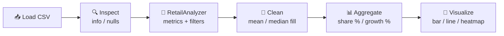

<div align="center">

# 🛒 Retail Sales Data Analyzer

### An object-oriented, end-to-end sales analytics project built with Python

[](https://www.python.org/)
[](https://pandas.pydata.org/)
[](https://numpy.org/)
[](https://seaborn.pydata.org/)
[](https://jupyter.org/)

*Load → Clean → Analyze → Visualize — all in one notebook.*

</div>

---

## 📑 Table of Contents

- [Overview](#-overview)
- [Key Highlights](#-key-highlights)
- [Tech Stack](#-tech-stack)
- [Dataset](#-dataset)
- [Project Architecture](#-project-architecture)
- [Getting Started](#-getting-started)
- [Usage](#-usage)
- [Analysis Workflow](#-analysis-workflow)
- [Results & Insights](#-results--insights)
- [Visualizations](#-visualizations)
- [Future Improvements](#-future-improvements)
- [Contributing](#-contributing)
- [Author](#-author)

---

## 🔍 Overview

**Retail Sales Data Analyzer** is a data analysis project that turns raw retail transaction data into clear business insights. It wraps the core logic in a reusable **`RetailAnalyzer`** class (OOP), then goes deeper with **NumPy** and **Pandas** data manipulation and **Seaborn / Matplotlib** visualizations.

It answers questions such as:

- 💰 How much did the store sell in total, and what is the average sale?
- 🏆 Which product sells the most often?
- 📦 Which category drives the most revenue?
- 📈 How do sales grow or shrink month over month?
- 🔗 How are price, quantity and total sales related?

---

## ✨ Key Highlights

| Feature | Description |
|---|---|
| 🧱 **OOP Design** | A reusable `RetailAnalyzer` class with `load_data`, `calculate_metrics`, `filter_data` and `display_summary` methods |
| 🧹 **Data Cleaning** | Missing `Price` filled with the **mean**, missing `Quantity Sold` filled with the **median**, and `Total Sales` recomputed as `Price × Quantity` |
| 🔎 **Flexible Filtering** | Filter by **category** and/or **date range** with a single dictionary |
| 📊 **Aggregations** | Category share (%), month-over-month growth rate, and per-category totals, averages and quantities |
| 🎨 **Visualizations** | Bar chart, line graph and correlation heatmap |

---

## 🧰 Tech Stack

- **Language:** Python 3
- **Data handling:** Pandas, NumPy
- **Visualization:** Matplotlib, Seaborn
- **Environment:** Jupyter Notebook

---

## 🗂 Dataset

The analysis runs on `retail_sales.csv` — **500 transactions** covering **January–December 2025**.

| Column | Type | Description |
|---|---|---|
| `Date` | string → datetime | Date of the sale |
| `Product` | string | Product name (e.g. Jeans, Smartwatch, Rice 5kg) |
| `Category` | string | `Clothing`, `Electronics`, `Groceries` or `Home` |
| `Price` | float | Unit price |
| `Quantity Sold` | float | Units sold in the transaction |
| `Total Sales` | float | Revenue (`Price × Quantity Sold`) |

> ⚠️ The raw data contains **5 missing values** each in `Price`, `Quantity Sold` and `Total Sales`. These are handled in the cleaning step.

---

## 🏗 Project Architecture

```
Retail-Sales-Data-Analyzer/
│
├── 📓 Retail_Sales_Data_Analyzer.ipynb   # Main notebook
├── 📄 retail_sales.csv                   # Dataset (add your own copy)
├── 🖼  assets/                            # Charts used in this README
│   ├── category_sales_bar.png
│   ├── monthly_sales_trend.png
│   └── correlation_heatmap.png
└── 📘 README.md
```

### The `RetailAnalyzer` class

```python
class RetailAnalyzer:
    def __init__(self): ...                  # df + metrics store
    def load_data(self, file_path): ...      # read the CSV into a DataFrame
    def calculate_metrics(self): ...         # total, average, most popular product
    def filter_data(self, condition): ...    # category and/or date-range filter
    def display_summary(self): ...           # formatted summary report
```

---

## 🚀 Getting Started

### Prerequisites

- Python 3.9 or higher
- pip

### Installation

```bash
# 1. Clone the repository
git clone https://github.com/<your-username>/Retail-Sales-Data-Analyzer.git
cd Retail-Sales-Data-Analyzer

# 2. (Optional) create a virtual environment
python -m venv venv
source venv/bin/activate        # Windows: venv\Scripts\activate

# 3. Install dependencies
pip install numpy pandas matplotlib seaborn jupyter

# 4. Launch the notebook
jupyter notebook Retail_Sales_Data_Analyzer.ipynb
```

> 📌 **Note:** the notebook currently reads the CSV from a local Windows path. Update it to point to your file, for example `retail_sales.csv` in the project folder.

---

## 💡 Usage

```python
analyzer = RetailAnalyzer()
analyzer.load_data("retail_sales.csv")

# 1️⃣ Calculate and show key metrics
analyzer.calculate_metrics()
analyzer.display_summary()

# 2️⃣ Filter by category
electronics = analyzer.filter_data({"Category": "Electronics"})

# 3️⃣ Filter by category + date range
q1_electronics = analyzer.filter_data({
    "Category": "Electronics",
    "start_date": "2025-01-01",
    "end_date": "2025-03-31",
})
```

**Sample output**

```
===== Retail Sales Summary =====
Total Sales     : 5373980.0
Average Sales   : 10856.53
Popular Product : Rice 5kg
================================
```

---

## 🔄 Analysis Workflow



1. **Load & inspect** the data with `df.info()` and a null-value check.
2. **Build the OOP analyzer** to compute metrics and apply filters.
3. **Manipulate data** with NumPy and Pandas: sales percentage per category, monthly growth rate, missing-value imputation and `groupby` aggregations.
4. **Visualize** the results with Seaborn and Matplotlib.

---

## 📈 Results & Insights

### Headline metrics

| Metric | Value |
|---|---|
| 💰 Total Sales | **₹53,73,980** (5,373,980) |
| 📊 Average Sale | **₹10,856.53** |
| 🏆 Most Popular Product | **Rice 5kg** |

### Category performance

| Category | Share of Sales | Total Sales | Avg. Sale | Units Sold |
|---|---:|---:|---:|---:|
| 🔌 Electronics | **66.30%** | 35,98,685 | 28,789 | 282 |
| 👕 Clothing | 18.39% | 10,21,000 | 8,234 | 498 |
| 🏠 Home | 10.12% | 5,90,490 | 4,880 | 523 |
| 🛒 Groceries | 5.19% | 3,78,146 | 2,909 | 781 |

### Takeaways

- 🔌 **Electronics dominate revenue** — about two-thirds of all sales from just 282 units.
- 🛒 **Groceries lead in volume, not value** — the most units sold (781) but the smallest revenue share.
- 📉 **Sales are highly volatile** — month-over-month growth swings sharply, from roughly **+111%** (July) to **−52%** (April).

> Monthly growth rate = `monthly_sales.pct_change() × 100`

---

## 🖼 Visualizations


category_sales_bar 


monthly_sales_trend 


correlation_heatmap 

---

## 👤 Author

**Shiva**


---

<div align="center">

 

</div>
